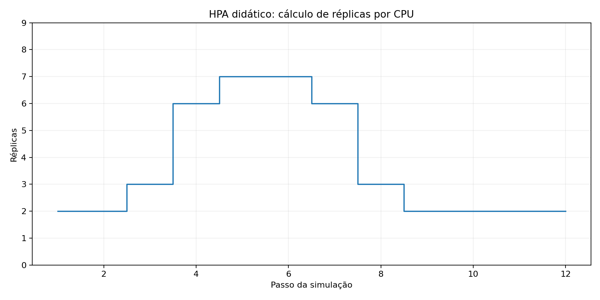

# ☸️ DevOps / SRE — HPA: da prontidão à capacidade

  

> Laboratório 02 — continuação de liveness/readiness. Cenários de carga sintéticos; sem infraestrutura cloud exigida.

## 🧭 Trilha

| Etapa | Objetivo |
|---|---|
| [01 — Probes](notebooks/Laboratorio_Liveness_Readiness_Quedas.ipynb) | Liveness e readiness durante falhas |
| [02 — HPA](notebooks/Laboratorio_HPA_Escalonamento_Didatico.ipynb) | Cálculo didático de réplicas sob variações de CPU |

## 🧪 Executar no laboratório existente

Não substitua o `README.md` nem o `pyproject.toml` do laboratório. Copie apenas este arquivo, o notebook e o gráfico.

```bash
cd ~/PythonProjects/devops_probes_lab
conda activate devops-probes
python --version
python -m pip install .
```

Abra `notebooks/Laboratorio_HPA_Escalonamento_Didatico.ipynb` e selecione o kernel `devops-probes`. Execute todas as células.

## 📈 Modelo e limites

A fórmula básica é `ceil(replicas × uso_atual / uso_alvo)`, com limites mínimo e máximo e tolerância. A simulação simplifica o HPA e **não** implementa policies, cooldown, métricas ausentes, pods NotReady ou estabilização de downscale. Sem execução em cluster real.



## 📚 Fontes

- [Kubernetes — Horizontal Pod Autoscaling](https://kubernetes.io/docs/concepts/workloads/autoscaling/horizontal-pod-autoscale/)
- [Kubernetes — HPA API v2](https://kubernetes.io/docs/reference/kubernetes-api/autoscaling/horizontal-pod-autoscaler-v2/)
